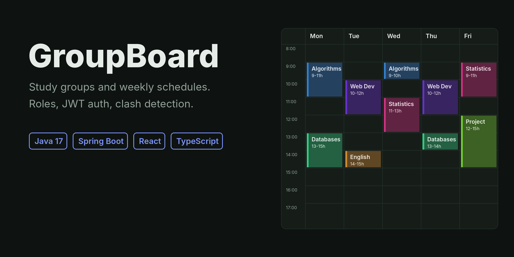
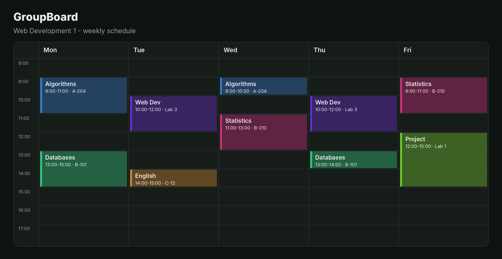
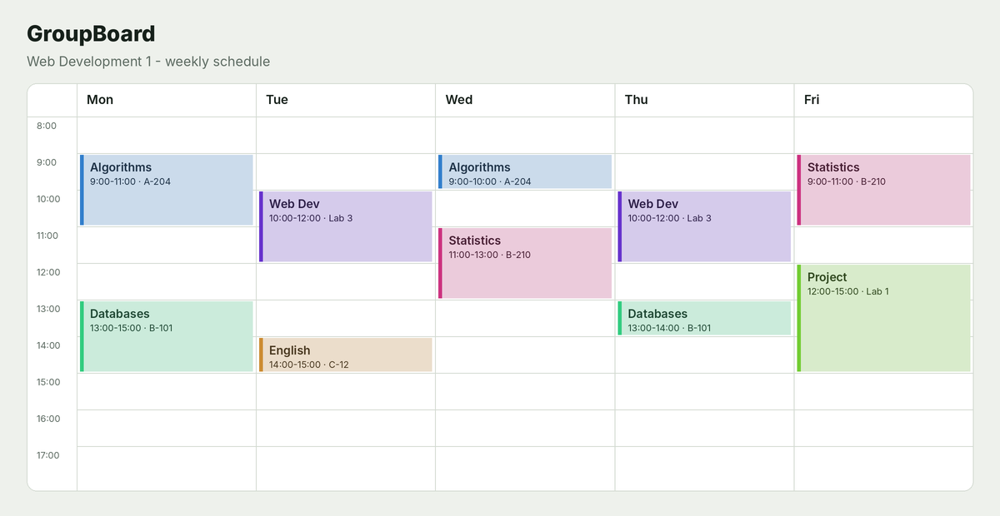

<p align="center"></p>

# GroupBoard

Study-group and weekly-schedule manager. A Spring Boot REST API with JWT auth and roles, and a React + TypeScript interface with light and dark themes.




*Images show the schedule view in both themes.*

## Features

- **Roles**: admins manage groups and students; teachers edit the schedule.
- **Weekly timetable** with colour-coded lessons; overlapping lessons in one group are rejected.
- **Paginated group search**, server-side validation, clear error messages.
- **Stateless JWT** authentication, CORS configured for the dev UI.
- CI on every push: backend tests and frontend build.

## Stack

Java 17, Spring Boot 3.3, Spring Security, Spring Data JPA, H2 · React 18, TypeScript, Vite

## Run

```bash
# API on :8080
cd backend && mvn spring-boot:run

# UI on :5173 (second terminal)
cd frontend && npm install && npm run dev
```

On first start the API creates two accounts, `admin` and `teacher`. Set their passwords and the token secret before running anywhere but your own machine:

```bash
export ADMIN_PASSWORD=... TEACHER_PASSWORD=... JWT_SECRET=<32+ characters>
```

The defaults are for local development only.

## API

| Method | Path | Role |
|---|---|---|
| POST | `/api/auth/login` | public |
| GET | `/api/groups?q=&page=&size=` | any |
| POST, DELETE | `/api/groups`, `/api/groups/{id}` | admin |
| GET | `/api/groups/{id}/students`, `/api/groups/{id}/lessons` | any |
| POST, DELETE | `/api/students` | admin |
| POST, DELETE | `/api/lessons` | admin, teacher |

## Test

```bash
cd backend && mvn verify
```
